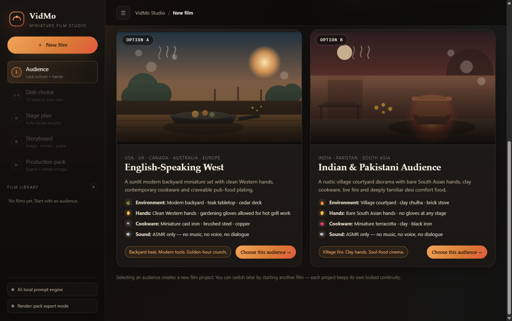
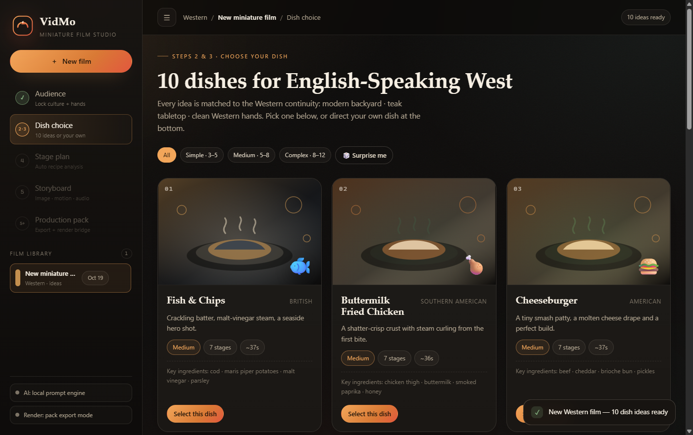
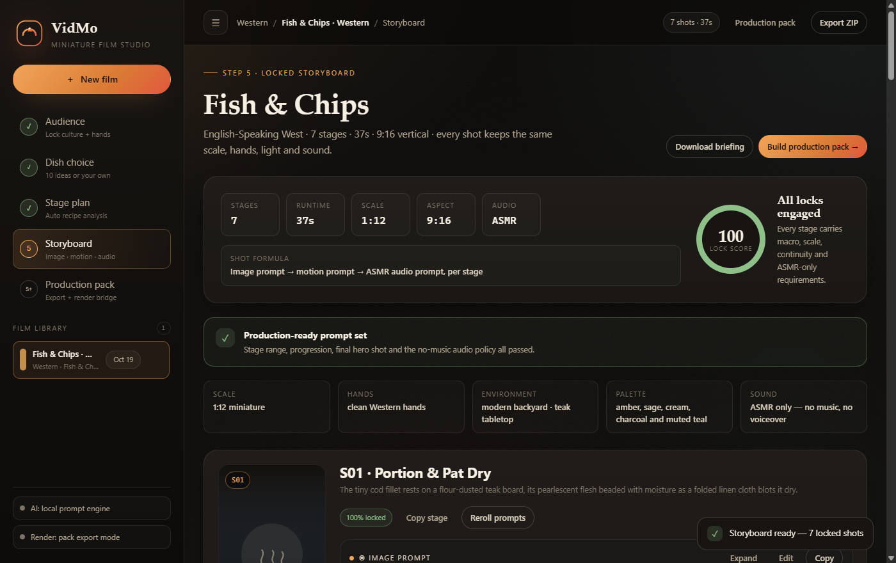

# VidMo Studio

**A miniature-cooking film director in a box.** Give it an audience and a dish, and it produces a complete vertical-video production package: a recipe-aware stage plan, extreme-macro image prompts, physically believable motion prompts, a strict ASMR-only audio policy, and every export a renderer or editor needs. Then it can finish the job inside your **own Google Flow account**: generate the stage images, approve the best take per stage, and animate each approved image into an image-to-video clip — without VidMo ever seeing your Google password.

Built for the viral "miniature cooking" Shorts/Reels format: **giant human hands + tiny hyper-realistic food + extreme macro + ASMR**.

[](https://github.com/F4Y547/vidmo/actions/workflows/ci.yml)
[](LICENSE)
[](https://nodejs.org)
[](#quick-start)
[](#google-flow-generation)
[](test)
[](scripts/smoke.mjs)

| Audience lock | Dish choice |
| --- | --- |
|  |  |



## Why this exists

Anyone can prompt a video model once. The hard part of the miniature-cooking format is **consistency across a whole film**: the same hands, the same tiny cookware, the same light, a believable 1:12 scale, and sound that is pure ASMR — no music, no voice, no exceptions. VidMo Studio encodes those rules as locked prompt blocks, audits every edit against them, and keeps every shot on-model from the first cut to the plating hero shot.

## Quick start

```bash
npm start          # → http://127.0.0.1:4173
npm install playwright-core   # optional: enables generate-in-your-Flow-account
```

Requires Node 20.12+ (22 LTS recommended). No install step, no build step, **zero core dependencies** — the optional Flow driver is the only package, and everything else works without it.

```bash
npm test           # engine + API + Flow pipeline test suite (built-in node:test)
npm run test:flow  # mock-Flow browser automation tests
npm run smoke      # live end-to-end smoke test against a running server
npm run dev        # auto-restarting dev server
npm run flow:discover  # capture the signed-in Flow DOM for selector maintenance
```

## The 5-step workflow

1. **Audience** — pick *English-Speaking West* or *India & Pakistan*. This choice locks the continuity bible: environment, hands, cookware, lighting, palette, ambience and cultural rules — re-applied to every single stage prompt.
2. **Dish ideas** — 10 hand-authored, audience-matched dishes, each with a curated stage plan, complexity tier and estimated runtime.
3. **Dish choice** — pick one of the ten, or type any custom dish (name + ingredients). Custom dishes are analyzed locally (keyword signals + ingredient count) or optionally by an AI planner, and get a stage count that follows real recipe complexity.
4. **Stage plan** — stage count follows complexity, never a fixed number: **simple 3–5, medium 5–8, complex 8–12** stages, targeting a 20–60s total runtime.
5. **Storyboard** — every stage ships three locked prompts:
   - **Image** — extreme macro photography, hyper-realistic miniature, giant hands vs. tiny food, correct stage/ingredients, tiny cookware, shallow DOF, cinematic lighting, 8K detail, viral Shorts framing, explicit progression from the previous stage.
   - **Motion** — start frame matched to the image, timed movement, camera behavior, scale and continuity locks.
   - **Audio** — ASMR only: no music, no background music, no songs, no voiceover, no dialogue, no human speech. Ever.

The final stage of every film is always the plating hero: finished dish, professional garnish, tiny serving plate, giant fingers making the final adjustment — the most appetizing, thumbnail-worthy frame of the sequence.

Prompt editing and rerolling are built in, and every edit is **audited**: break a production lock (e.g. remove the macro requirement) and the lock score drops, the failing stage is flagged with exactly what's missing, and one click rerolls the prompts back to a compliant state.

## Guaranteed production rules

These are enforced in the prompt engine and asserted by the test suite — they cannot be bypassed, including by the AI planner (which may only propose recipe stages, never the final prompts):

- Every stage carries **image + motion + audio** prompts.
- **Extreme macro photography** with a tack-sharp focus on the current cooking state.
- **Giant human hands vs. tiny food** scale contrast (hands ≈ 12× the cookware height; the dish smaller than a fingertip).
- **Continuity locks** on every stage: environment, hands, cookware family, light direction, palette and table surface.
- **ASMR-only audio** on every shot: no music, no songs, no voiceover, no dialogue, no human speech.
- **Complexity-based stage count** (3–5 / 5–8 / 8–12) with a plated **hero shot** as the final stage.

## Google Flow generation

The storyboard step can drive image and image-to-video generation inside **your own** Google Flow session, so the whole film comes out of one pipeline:

1. In the Flow panel, click **Connect Google Flow**. VidMo opens a visible Chrome window with its own local profile (`data/flow-profile`).
2. **You sign in to Google yourself** in that window. VidMo never asks for, proxies or stores your password, cookies or tokens — it attaches to a normal signed-in browser session you control.
3. **Generate all images** (or per-stage). Prompts are written from the locked storyboard: 9:16, image model, one job at a time, with credit warnings before every batch.
4. **Review and approve one image take per stage.** The clip buttons stay locked until a stage image is approved — approved images become the image-to-video start frames.
5. **Generate all clips.** Flow animates each approved image with the locked motion prompt.
6. Download, reroll, upload your own takes, or remove assets per stage. Everything is stored locally under `data/media/` and is included in the ZIP and Flow pack exports.

Design constraints:

- **Google Flow has no public generation API.** VidMo automates the real signed-in web app in a visible browser window — no iframe embedding, no OAuth shortcuts, no private endpoints.
- **Your credits, your account.** Flow generations consume Flow credits from your own Google account; VidMo does not include, resell or proxy credits.
- **Nothing is bypassed.** If Flow shows a captcha, a credit warning, new terms or an unexpected UI, VidMo pauses generation, saves a screenshot and waits for you to resolve it in the Flow window, then Resume.
- **Fail-safe fallback.** Every project always exports a **Flow pack** (openable board, per-stage image/video prompts, manifest, shot list and import-back instructions) so manual Flow work or any other model works with zero automation.
- **Selectors are transparent and editable.** Flow's DOM is not a public API; the selector map lives in `src/server/flow/selectors.js` and can be overridden per machine with `data/flow/selectors.json`. `npm run flow:discover` captures the live DOM, a screenshot and a `selectors.suggested.json` while you are signed in.

The Flow driver is the only optional dependency: `npm install playwright-core`. Without it, the core studio, all prompts and all exports still work — Connect simply reports the missing driver.

To try the whole pipeline without a Google account (no credits, placeholder media): start the server with `VIDMO_FLOW_MODE=stub`.

## Exports

From the Production pack step (or directly via API):

| Artifact | What it is |
| --- | --- |
| `format=md` | Director briefing: continuity bible + full storyboard |
| `format=csv` | Shot list, spreadsheet-ready with all prompts |
| `format=json` | Machine-readable project schema |
| `format=handoff` | Model-agnostic render job manifest |
| `format=flow` | Google Flow pack: browser board, per-stage image/video prompts, manifest, shot list, import-back doc and any generated media |
| `format=zip` | Full production pack: README, manifest, shot list, continuity doc, social copy, per-stage prompt files, Flow pack and generated media |

The ZIP also includes a social copy pack: titles, hooks, captions, hashtags and platform copy for YouTube Shorts, TikTok and Reels.

## Render bridge

Live rendering is external. Two ways to finish a film:

- **Pack export mode (default)** — download the ZIP or handoff JSON and submit shots to a video model yourself (tested flows: Veo 3.1, Kling 2.5, Runway Gen-4, Sora 2).
- **Webhook mode** — set `VIDMO_RENDER_WEBHOOK` and the studio submits the full handoff manifest automatically. `POST /api/projects/:id/render` queues all shots; renderers report per-stage progress back to `/api/render/callback` (optionally secured with `VIDMO_RENDER_CALLBACK_SECRET`), and the studio tracks submitted → in-progress → complete per stage.

## Configuration

Everything is optional — see [`.env.example`](.env.example) for the full list. Without a `.env` file the studio runs fully offline with the deterministic local planner.

| Variable | Purpose |
| --- | --- |
| `PORT`, `HOST` | Local server address (default `4173` / `127.0.0.1`) |
| `VIDMO_DATA_DIR` | Where `store.json` is written (default `./data`) |
| `OPENAI_API_KEY` / `VIDMO_AI_API_KEY` | Enables the optional AI recipe planner |
| `OPENAI_BASE_URL`, `OPENAI_MODEL` | Any OpenAI-compatible endpoint and model |
| `VIDMO_RENDER_WEBHOOK`, `VIDMO_RENDER_WEBHOOK_TOKEN` | Render bridge submission |
| `VIDMO_PUBLIC_URL` | Public URL used for render callbacks |
| `VIDMO_RENDER_CALLBACK_SECRET` | Required `X-VidMo-Secret` header on callbacks |
| `VIDMO_FLOW_MODE` | `browser` (default) or `stub` simulator |
| `VIDMO_FLOW_BROWSER` | Explicit Chrome/Edge executable path |
| `VIDMO_FLOW_HEADLESS` | `1` to hide the Flow window (sign-in still needs a visible run once) |
| `VIDMO_FLOW_PROFILE_DIR`, `VIDMO_FLOW_DIR` | Local Flow profile and diagnostics location |
| `VIDMO_FLOW_IMAGE_MODEL`, `VIDMO_FLOW_VIDEO_MODEL` | Preferred Flow models when the picker is available |
| `VIDMO_FLOW_IMAGE_TIMEOUT_MS`, `VIDMO_FLOW_VIDEO_TIMEOUT_MS` | Generation timeouts (images ~8 min, clips ~25 min by default) |

> `.env` file loading uses Node's `process.loadEnvFile` (Node 20.12+). On older runtimes, set environment variables directly.

## API sketch

```
GET    /api/health
GET    /api/bootstrap                     audiences, projects, settings, Flow status
GET    /api/ai/status                     planner configuration
POST   /api/analyze                       custom-dish complexity analysis
GET    /api/projects                      film library
POST   /api/projects                      { audience: "western" | "desi" }
GET    /api/projects/:id
DELETE /api/projects/:id
POST   /api/projects/:id/select           { dishId } or { dishId: "custom", customDish: { name, ingredients } }
POST   /api/projects/:id/storyboard       build the locked prompt set
PATCH  /api/projects/:id/stage/:n         edit a stage prompt (audited)
POST   /api/projects/:id/stage/:n/reroll  regenerate a stage's prompts
GET    /api/projects/:id/export?format=md|csv|json|handoff|flow|zip
POST   /api/projects/:id/render           submit via render bridge
POST   /api/render/callback               renderer status reports
GET    /api/flow/status                   Flow session descriptor
POST   /api/flow/connect|disconnect|pause|resume|focus|diagnostics
GET    /api/flow/screenshot               latest local Flow screenshot
POST   /api/projects/:id/generate/images  queue Flow image generations (one job at a time)
POST   /api/projects/:id/generate/clips   queue image-to-video clips (needs approved images)
POST   /api/projects/:id/generate/cancel  cancel the active batch
GET    /api/projects/:id/generation       live generation status per stage
POST   /api/projects/:id/approve-images   approve the latest image take per stage
POST   /api/projects/:id/stages/:n/assets upload own image/clip for a stage
PATCH  /api/projects/:id/stages/:n/assets/:assetId   approve/unapprove an asset
DELETE /api/projects/:id/stages/:n/assets/:assetId   remove an asset and its local file
GET    /api/projects/:id/media/:stage/:file          stream local media (Range supported)
```

## Project structure

```
server.js                 entry point
src/server/app.js         REST API, static serving, render bridge, Flow routes
src/server/store.js       JSON persistence (serialized write queue)
src/server/media.js       local media storage, validation, Range streaming
src/server/generation.js  Flow generation queue, asset approval, pack collection
src/server/flow/          Flow session, automation, selectors, simulator, errors
src/server/zip.js         dependency-free ZIP writer
src/server/ai.js          optional OpenAI-compatible planner
src/engine/audiences.js   the two continuity bibles
src/engine/dishes/        20 hand-authored dishes with stage beats
src/engine/custom.js      custom-dish complexity detection + stage templates
src/engine/prompts.js     image/motion/audio prompt builders + audits
src/engine/flow.js        Flow prompts, board, manifest, shot list, pack files
src/engine/exports.js     markdown/CSV/JSON/handoff/pack builders
src/web/                  the studio UI (vanilla JS SPA, no build step)
test/                     engine, API, stub-generation and mock-Flow tests
scripts/smoke.mjs         live end-to-end smoke test
scripts/flow-discover.mjs signed-in Flow DOM discovery (S0 spike)
```

Films are persisted to `data/store.json` (gitignored). Generated media lives under `data/media/`, the Flow browser profile under `data/flow-profile/` and Flow diagnostics under `data/flow/diagnostics/`. Deleting `data/` resets the studio and the local Flow session.

## Development

- `npm test` — 16 tests: engine rules, the API workflow, the stub Flow pipeline (images → approval → clips → media → packs) and a mock-Flow browser test for the automation layer.
- `npm run test:flow` — the mock-Flow Playwright tests only.
- `npm run smoke` — 60+ live checks: the full workflow, all prompt locks, custom dishes, every export format, the Flow pack and (with `VIDMO_FLOW_MODE=stub`) end-to-end generation and media streaming.
- `npm run flow:discover` — signed-in Flow DOM capture for selector maintenance.
- CI runs both on Node 20, 22 and 24 for every push and pull request.

Contributions are welcome — see [CONTRIBUTING.md](CONTRIBUTING.md). This project follows the [Contributor Covenant](CODE_OF_CONDUCT.md), and security reports should follow [SECURITY.md](SECURITY.md).

## License

[MIT](LICENSE) © Faysal Matheen
